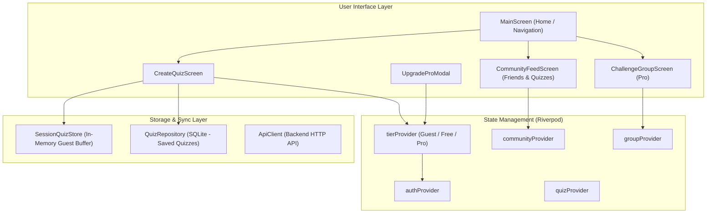

# Architectural Specification: Multi-Tier Quiz Creation, Quota, and Community System

## 1. Overview & Objectives
This document specifies the architecture, permissions, storage, and UI flows for quiz authoring, quotas, and social features across three user tiers in the Quick Quiz mobile application:
1. **Guest (Unauthenticated)**: In-memory session quiz creation (max 20), predefined topics only, no SQLite persistence, no cloud sync.
2. **Authenticated Player (80% Standard Tier)**: Up to 100 quizzes per list, custom topic creation, SQLite persistence, cloud sync, community feed publication for friends, and leaderboard access.
3. **Pro Package (100% Full Tier)**: Unlimited quizzes per list, unlimited custom topics, creation and management of Challenge Groups with dedicated leaderboards, top ranking privileges.

---

## 2. Quota & Capability Matrix

| Feature / Permission | Guest (Unauthenticated) | Authenticated (80% Tier) | Pro Package (Full Tier) |
| :--- | :---: | :---: | :---: |
| **Max Quizzes in Active List** | **20** | **100** | **Unlimited** (no cap) |
| **Topic Creation** | Predefined list only (General, Tech, Web3, DeFi, Science) | **Allowed** (Create custom topics) | **Allowed** (Unlimited custom topics) |
| **Persistence Mechanism** | **In-memory session only** (wiped on app close) | Local SQLite DB + Auto Sync | Local SQLite DB + Auto Sync |
| **Cloud Synchronization** | None | Full (`/quiz/sync`, `/questions`) | Full (`/quiz/sync`, `/questions`) |
| **Community Feed & Sharing** | Can play community quizzes | Can publish quizzes for friends | Can publish quizzes for friends |
| **Leaderboard Access** | View-only | Full (Submit & Rank) | Full (Submit & Rank + Pro Badge) |
| **Challenge Groups** | Locked (Shows Upgrade Prompt) | Locked (Shows Upgrade Prompt) | **Unlocked** (Create Challenge Groups) |

---

## 3. Architecture & Unit Components

### 3.1 `TierProvider` & Capabilities
- **Location:** `mobile/lib/services/tier/tier_provider.dart`
- **Model:**
  - `UserTier`: `enum UserTier { guest, free, pro }`
  - `TierCapabilities`:
    - `int maxQuizzesPerList` (20, 100, 999999)
    - `bool canCreateCustomTopic` (false for guest, true for free/pro)
    - `bool persistsToDisk` (false for guest, true for free/pro)
    - `bool canSyncWithServer` (false for guest, true for free/pro)
    - `bool canCreateChallengeGroup` (false for guest/free, true for pro)
    - `bool canPublishToCommunity` (false for guest, true for free/pro)
- Controlled via `tierProvider` watching `authProvider` and user profile tier data, with methods `upgradeToPro()` and `downgradeToFree()` for mock/purchased state.

### 3.2 In-Memory Session Storage for Guests
- **Location:** `mobile/lib/services/tier/session_quiz_store.dart`
- Manages up to 20 temporary questions in RAM only.
- Does not invoke `DatabaseHelper` or SQLite.
- Cleared when app lifecycle state transitions to detached or user explicitly resets.
- If guest signs in before closing the app, session questions can be migrated to `QuizRepository`.

### 3.3 Create Quiz UI (`CreateQuizScreen`)
- **Location:** `mobile/lib/features/quiz/create_quiz_screen.dart`
- **Fields:**
  - Prompt text field (required)
  - Category / Topic:
    - Guests: Dropdown selector restricted to predefined topics (General, Tech, Web3, DeFi, Science). Custom topic input is disabled with a *"Sign in to create custom topics"* badge.
    - Authenticated / Pro: Dropdown selector + "Add New Topic" button that opens an inline topic creator.
  - 4 Option text fields (A, B, C, D)
  - Correct answer selector (radio chips A, B, C, D)
  - Progress quota badge: `X / 20 (Guest Session)` or `X / 100 (Free Tier)` or `X (Pro Unlimited)`
  - Submitting:
    - Guests: Validates limit ($\le 20$), adds to `SessionQuizStore`, immediately available in session quiz list.
    - Authenticated: Validates limit ($\le 100$), saves to `QuizRepository` and posts to backend `/questions` if online.
    - Pro: Saves with no limit and offers "Add to Challenge Group".

### 3.4 Community Quiz Feed
- **Location:** `mobile/lib/features/community/community_feed_screen.dart`
- Lists published quizzes from friends and community members.
- Shows author name, topic tag, number of questions, and "Play Quiz" button.
- Tapping "Play Quiz" loads the questions into `quizProvider` and starts the session.

### 3.5 Pro Challenge Groups
- **Location:** `mobile/lib/features/groups/challenge_group_screen.dart`
- Pro users can create a challenge group, set a target score, and view participants' ranks.
- Authenticated Free and Guest users see the group and leaderboard, with an "Upgrade to Pro" banner explaining how Pro owners can create their own groups and cross-top leaderboard ranks.

---

## 4. Test & Verification Plan
1. **Unit Tests:**
   - `test/tier_provider_test.dart`: Verifies quota calculations for Guest (20), Free (100), and Pro ($\infty$), along with topic creation permission checks.
   - `test/session_quiz_store_test.dart`: Verifies in-memory storage respects the 20-quiz limit and does not touch SQLite.
2. **Widget Tests:**
   - `test/create_quiz_screen_test.dart`:
     - Guest cannot create custom topics and cannot exceed 20 quizzes.
     - Authenticated user can create custom topics and add up to 100 quizzes.
     - Pro user has full limits.
   - `test/community_feed_test.dart`: Community feed displays questions and allows play.
   - `test/challenge_group_test.dart`: Group creation gate requires Pro tier.
3. **Static Analysis & Build:**
   - 0 warnings in `flutter analyze`.
   - All tests green via `flutter test`.
   - Clean release APK build.
