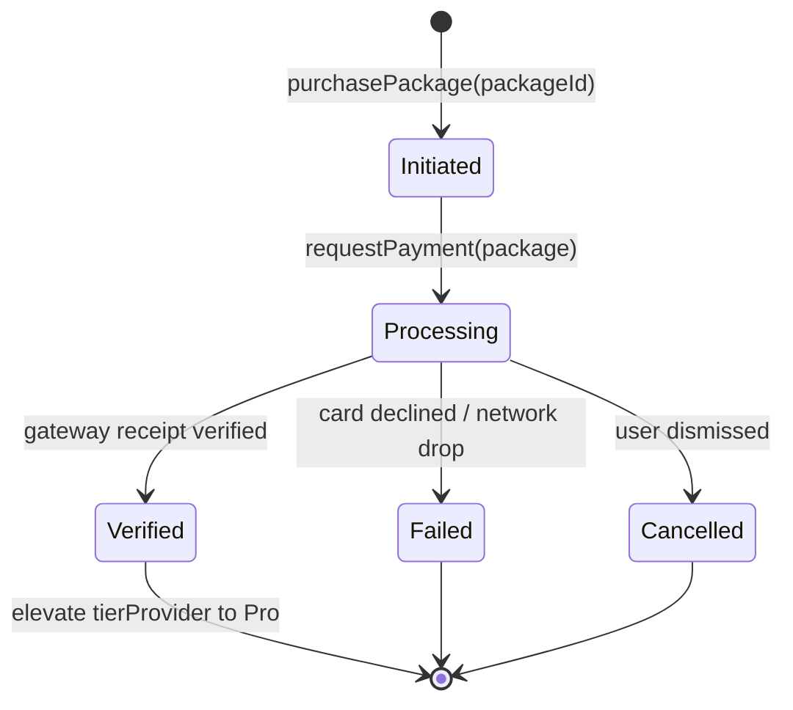

# Spec: SDK Transaction Manager for Package Upgrades

**Date:** 2026-10-22  
**Status:** Approved  
**Author:** Pair Programming Agent & User  
**Target Architecture:** Universal SDK (`sdk/`) in TypeScript and Dart, with Flutter Mobile integration  

---

## 1. Overview & Business Context

Quick Quiz implements a 3-tier user quota architecture:
- **Guest Tier:** In-memory only (max 20 quizzes per session, no save, no server sync, predefined topics only).
- **Free Tier (80%):** Authenticated player (max 100 quizzes, custom topics, SQLite save & cloud sync, friend community).
- **Pro Tier (100% Full Limit):** Paid upgrade unlocking unlimited quizzes, Open Challenge Groups, dedicated group leaderboards, and Challenger rank boost multipliers.

To enable users to upgrade their package, we introduce the **SDK Transaction Manager**, a unified transaction engine housed within the `sdk/` directory. It coordinates package discovery, transaction initiation, payment gateway handoff, receipt verification, entitlement restoration, and tier elevation.

---

## 2. Constraints & Requirements

1. **Folder Boundary:** All core SDK transaction logic, contracts, models, and adapters MUST be located within the `sdk/` directory:
   - TypeScript SDK: `sdk/src/client/transactions.ts`, `sdk/src/types.ts`, `sdk/src/index.ts`.
   - Dart SDK: `sdk/dart/lib/src/transactions.dart`, `sdk/dart/lib/src/models.dart`, `sdk/dart/lib/quickquiz_sdk.dart`.
2. **Package Catalog:** Supports 3 standard Pro packages:
   - `pro_monthly` ($4.99/mo)
   - `pro_annual` ($39.99/yr, "Save 33% — Best Value")
   - `pro_lifetime` ($79.99 one-time full limit unlock)
3. **Pluggable Settlement:**
   - Pluggable `PaymentGatewayAdapter` interface with a built-in `SandboxGatewayAdapter` for immediate, zero-friction testing/demo modes.
   - Idempotent transaction IDs, receipts, and structured status states: `initiated` -> `processing` -> `verified` / `failed` / `cancelled` / `refunded`.
4. **Mobile Integration:**
   - Flutter integration via Riverpod service linking `TransactionManager` to `tierProvider.notifier.upgradeToPro()` upon `verified` status.
   - Interactive upgrade modal displaying package cards and real-time transaction state feedback.
5. **Quality & Verification:**
   - Clean compilation in TypeScript (`npm --prefix sdk run type-check && npm --prefix sdk run build`).
   - Clean Dart tests in `sdk/dart/test/transactions_test.dart`.
   - 0 warnings in `flutter analyze` and 100% passing test suite in `mobile/`.

---

## 3. Architecture & Data Contracts

### 3.1 Domain Models

```ts
export type PackageId = 'pro_monthly' | 'pro_annual' | 'pro_lifetime';

export type TransactionStatus =
  | 'initiated'
  | 'processing'
  | 'verified'
  | 'failed'
  | 'cancelled'
  | 'refunded';

export type BillingInterval = 'month' | 'year' | 'lifetime';

export interface UpgradePackage {
  id: PackageId;
  name: string;
  description: string;
  price: number;
  currency: string;
  interval: BillingInterval;
  badge?: string;
  savingsPercentage?: number;
  features: string[];
}

export interface PackageTransaction {
  transactionId: string;
  packageId: PackageId;
  userId: string;
  amount: number;
  currency: string;
  status: TransactionStatus;
  gateway: 'sandbox' | 'google_play' | 'app_store' | 'stripe';
  receipt: string;
  startedAt: string;
  completedAt?: string;
  errorReason?: string;
}
```

### 3.2 State Machine Lifecycle



### 3.3 Gateway Adapter & Transaction Manager

```dart
abstract class PaymentGatewayAdapter {
  String get gatewayName;
  Future<PaymentResult> requestPayment(UpgradePackage package, {String? userId});
  Future<bool> verifyReceipt(String receipt, {required String transactionId});
}
```

```dart
class TransactionManager {
  final PaymentGatewayAdapter gateway;
  List<UpgradePackage> getPackages();
  Future<PackageTransaction> purchasePackage(PackageId packageId, {String? userId});
  Future<List<PackageTransaction>> restorePurchases({String? userId});
  List<PackageTransaction> getHistory();
}
```

---

## 4. Verification Plan

1. **Dart SDK Tests:**
   - `sdk/dart/test/transactions_test.dart`:
     - Test package catalog retrieval.
     - Test sandbox successful purchase lifecycle -> verified status.
     - Test sandbox failure (card declined) -> failed status.
     - Test sandbox cancellation -> cancelled status.
     - Test purchase restoration.
2. **TypeScript SDK Verification:**
   - Run `npm --prefix sdk run type-check`.
   - Run `npm --prefix sdk run build`.
3. **Flutter Mobile Integration Tests:**
   - `mobile/test/package_transaction_manager_test.dart`:
     - Test purchase elevates `tierProvider` to Pro.
     - Test transaction failure does not elevate tier.
     - Test package selection and purchase in UI modal.
4. **End-to-End Analysis:**
   - `flutter analyze` (0 issues).
   - `flutter test` (all tests pass).
